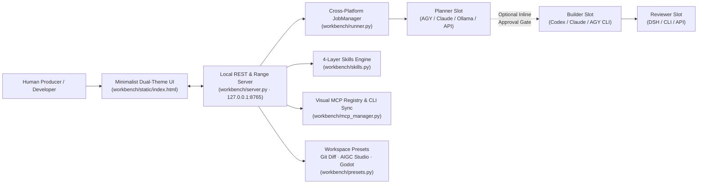

# Super Workbench

**Minimalist, Zero-Dependency Local Multi-Agent Orchestration Studio**

[English](README.md) · [简体中文](README_ZH.md)

Orchestrate your local AI CLIs (**Antigravity `agy`**, **OpenAI `codex`**, **Claude Code `claude`**, **Gemini CLI `gemini`**, **DSH**) alongside **Ollama** and any **OpenAI-compatible API** inside one calm, Muse / Codex / Linear-inspired workspace — built for both **Software Engineering** and **AIGC Production Pipelines**.

> **Core Philosophy**: Reuse the local AI CLI subscriptions you already pay for. Only the **Core Builder** slot needs a local file-editing CLI; **Planner** and **Reviewer** can freely bind to any CLI, local Ollama model, or cloud API.

---

## Highlights

- **Zero Extra Dependencies**: Pure Python 3 standard library backend + single-file HTML/CSS/JS frontend. No Docker, Redis, Node build pipeline, or database required.
- **Universal 3-Role Orchestration (`Planner` → `Builder` → `Reviewer`)**:
  - Real-time NDJSON & SSE streaming with collapsible execution traces.
  - 46px Codex-mini vertical paper-plane relay rail for instant handoff visibility.
  - Optional minimalist **Approve-Before-Build** pause gate in `Settings` (defaults to uninterrupted flow; when enabled, shows a single inline approval bar above the composer).
- **Multi-Workspace & Multi-Thread Conversations**:
  - Isolate projects cleanly across `General`, `Web`, `Python`, `AIGC Studio`, and `Godot Game` presets.
  - Multiple conversation threads per workspace with one-click **Context Compaction** (distills long histories into persistent working memory).
- **Codex / AGY-Style Multimodal Composer**:
  - `+` action button for uploading images, local files, or mounting `/skills`, plus `Ctrl+V` screenshot paste and drag-and-drop.
- **Visual Settings Center (Beginner-Friendly & Zero-JSON)**:
  - **Skills**: 4-layer auto-discovery (built-in, workbench library, per-project `.agents/skills/`, and read-only local `~/.codex/skills`, `~/.gemini/antigravity/skills`, `~/.claude/skills`), zero-YAML creation, and universal prompt injection across all engines.
  - **Visual MCP Manager**: One-click templates (Playwright, GitHub, Figma, ComfyUI, Filesystem) with direct sync to installed local `agy` / `codex` / `claude` CLIs.
  - **Roles & BYO Engines**: Auto-discovers installed CLIs & local Codex models, plus 1-click presets for Ollama, DeepSeek, OpenRouter, and custom CLI templates.
- **Upgraded Right Inspector Drawer** (collapsed by default):
  - **Live Console Stream** with smart scroll-lock.
  - **Live Git Diff & Line-Numbered Source Preview** (red/green unified diff when Git is present; graceful file preview fallback when not).
  - **AIGC Studio Screening Room**: 5-stage asset milestones (`01_script` → `05_output`), storyboard image gallery with lightbox zoom, and HTML5 `<video>` / `<audio>` playback with HTTP `206 Range` seeking.
- **Dual High-Craft Themes**: Obsidian Dark ⇄ Muse Paper Light.

---

## Architecture



---

## Quick Start

### Prerequisites
- **Python 3.10+** (standard library only — `pip install` is not required)
- At least one local AI CLI installed & signed in (e.g. `codex`, `agy`, `claude`, or `gemini`), **or** a local Ollama / OpenAI-compatible API endpoint.

### Launch

```bash
git clone https://github.com/ricardoashfordan-dot/SuperWorkbench.git
cd SuperWorkbench
python start.py
```

On Windows, double-click `Start-SuperWorkbench.cmd`; on macOS / Linux, run `./start.sh`.

The studio opens at **`http://127.0.0.1:8765`** (strictly bound to localhost by default).

### Environment Variables (Optional)

| Variable | Default | Description |
| --- | --- | --- |
| `SUPER_WORKBENCH_HOST` | `127.0.0.1` | Server bind address |
| `SUPER_WORKBENCH_PORT` | `8765` | Server port |
| `SUPER_WORKBENCH_DATA_DIR` | `./.workbench` | Directory for local state, threads, and uploads |

---

## Repository Layout

```text
SuperWorkbench/
├── start.py                     # Cross-platform launcher
├── start.sh                     # macOS / Linux launcher
├── Start-SuperWorkbench.cmd     # Windows one-click launcher
├── skills/                      # Built-in starter SKILL.md packs
│   ├── aigc-storyboard/
│   ├── code-review-strict/
│   └── git-commit-release/
├── workbench/
│   ├── config.py                # Dynamic paths, JSON state & app settings
│   ├── adapters.py              # Local CLI detection, model discovery & SSE API client
│   ├── threads.py               # Per-workspace multi-thread conversations & memory
│   ├── skills.py                # 4-layer SKILL.md discovery, CRUD & prompt injection
│   ├── mcp_manager.py           # Visual MCP registry & 1-click CLI sync
│   ├── presets.py               # Git Diff, AIGC Studio, and Godot preset scanners
│   ├── runner.py                # JobManager, stream parser & optional approval gate
│   ├── server.py                # Local ThreadingHTTPServer REST & Range media API
│   └── static/index.html        # Single-file dual-theme Muse/Codex UI
└── .workbench/                  # Local runtime data (gitignored, never committed)
```

---

## Security & Privacy

- **Localhost Only**: Binds strictly to `127.0.0.1` by default.
- **Zero Repo Leaks**: All runtime conversations, workspaces, API keys, MCP env secrets, and uploaded files are stored inside `.workbench/` (listed in `.gitignore`).
- **Safe CLI Execution**: Runs local CLIs with standard workspace-scoped permissions (never uses sandbox-bypass flags) and masks API keys / MCP tokens in UI snapshots.
- **Non-Destructive Workspace Removal**: Removing a workspace from the sidebar never deletes files on your hard drive.

---

## Contributing

Contributions for new starter Skills, MCP templates, and Workspace Presets are welcome! See [CONTRIBUTING.md](CONTRIBUTING.md).

## License

[MIT](LICENSE)
