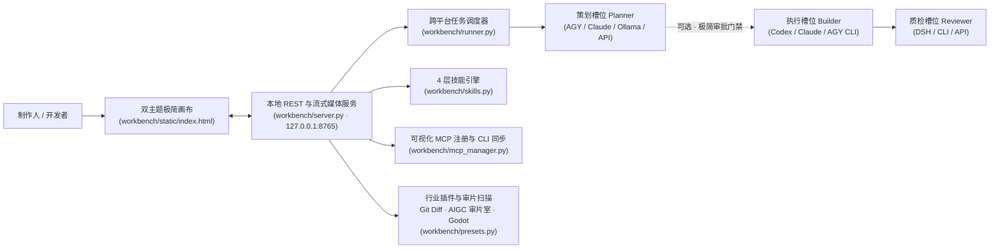

# Super Workbench

**零依赖、零额外 API 账单的本地多智能体协同工作台**

[English](README.md) · [简体中文](README_ZH.md)

在一个极简、冷静的 Muse / Codex / Linear 风格界面中，把你本机已经装好的 AI 命令行工具（**Antigravity `agy`**、**OpenAI `codex`**、**Claude Code `claude`**、**Gemini CLI `gemini`**、**DSH**）以及 **本地 Ollama / 任意 OpenAI 兼容 API** 串成一条顺手的协作流水线——同时服务于 **软件工程开发** 与 **AIGC 漫剧 / 短片制片**。

> **核心理念**：直接复用你已有的本地 CLI 订阅额度。只有 **核心执行（Builder）** 岗位需要绑定一个可改文件的本地 CLI，**策划（Planner）** 与 **质检（Reviewer）** 可以自由绑定 CLI、免费本地 Ollama 或任意云端 API。

---

## 核心特性

- **零重型依赖**：后端仅使用 Python 3 标准库，前端为单文件 HTML/CSS/JS；无需 Docker、Redis、数据库或前端编译环境，下载即用。
- **三角色自由协作（策划 → 执行 → 质检）**：
  - 实时流式输出与可折叠的执行步骤 Trace，拒绝满屏日志噪音。
  - 46px 极简纵向纸飞机交接微轨，一眼看清当前接力位置。
  - **极简执行前审批门禁（可选）**：在 `Settings → 角色与引擎` 中一键开关；开启后「全自动流转」会在策划出方案后暂停，并在输入框上方浮出一条安静的单行确认栏，点击「批准执行」才开始动手改文件。
- **多工作空间 & 同空间多对话 & 一键压缩上下文**：
  - 支持 `通用研发`、`Web 前端`、`Python`、`AIGC 制片空间`、`Godot 游戏开发` 等多种空间预设，互不干扰。
  - 每个工作空间支持建立多个独立对话线程，长对话可一键浓缩为长期记忆摘要，自动注入后续每轮上下文。
- **Codex / AGY 风格 `+` 多模态输入框**：
  - 点击 `+` 即可上传图片、本地文件或挂载 `/技能`，支持 `Ctrl+V` 直接粘贴截图与拖拽上传。
- **零门槛可视化 Settings 设置中心**：
  - **技能（Skills）**：4 层自动发现（内置、工作台技能库、项目 `.agents/skills/` 以及只读读取本机 `~/.codex/skills`、`~/.gemini/antigravity/skills`、`~/.claude/skills`），零 YAML 表单新建，自动注入所有引擎。
  - **外部工具（MCP）**：内置 Playwright 浏览器、GitHub、Figma、ComfyUI、本地目录等 1 键零 JSON 模板，并支持一键同步到本机已装的 `agy` / `codex` / `claude` CLI。
  - **角色与引擎**：自动探测本机 CLI 与 Codex 模型列表，并提供左下角 1 秒快切模型弹窗；一键接入 Ollama、DeepSeek、OpenRouter 或自定义 CLI。
- **可折叠右侧 Inspector 抽屉**（默认收起，保持画布纯净）：
  - **终端日志**：完整 CLI 实时输出，带智能滚动锁（上翻查看历史时绝不强制拽回底部）。
  - **Live Git Diff 与源码审查**：有 Git 时展示分支、变更文件与红绿 Diff；无 Git 时自动降级为带行号的源码预览。
  - **AIGC 漫剧 / 短片审片室**：自动初始化并追踪 5 级制片目录（`01_script` → `05_output`），内置分镜网格画廊与支持任意拖动进度条（HTTP `206 Range`）的 HTML5 音视频审片播放器。
- **Obsidian 暗夜 ⇄ Muse 纸白双主题**：精细打磨的排版、留白与极简图标体系。

---

## 整体架构



---

## 30 秒快速启动

### 环境要求
- **Python 3.10+**（纯标准库，无需 `pip install` 任何包）
- 至少安装并登录 1 个本地 AI CLI（如 `codex`、`agy`、`claude`、`gemini`），**或** 配置本地 Ollama / OpenAI 兼容 API。

### 启动方式

```bash
git clone https://github.com/ricardoashfordan-dot/SuperWorkbench.git
cd SuperWorkbench
python start.py
```

Windows 用户也可以直接双击根目录下的 `Start-SuperWorkbench.cmd`。

启动后浏览器访问 **`http://127.0.0.1:8765`**（默认仅监听本机回环地址）。

---

## 安全与隐私边界

- **仅限本机访问**：默认严格绑定 `127.0.0.1`，不向公网暴露任何端口。
- **个人数据完全隔离**：所有聊天记录、工作空间路径、API 密钥、MCP 环境变量与上传附件均存放在 `.workbench/` 目录下，已在 `.gitignore` 中排除，绝不会随代码提交泄漏。
- **安全执行策略**：调用本地 CLI 仅使用标准工作区沙箱权限（绝不注入绕过沙箱的危险参数），前端快照自动对密钥脱敏。
- **非破坏性空间移除**：从侧栏移除工作空间绝不会删除你硬盘上的项目文件。

---

## 参与贡献

欢迎提交新的内置 `SKILL.md` 模板、MCP 工具预设或行业工作流插件！详见 [CONTRIBUTING.md](CONTRIBUTING.md)。

## 开源协议

[MIT](LICENSE)
